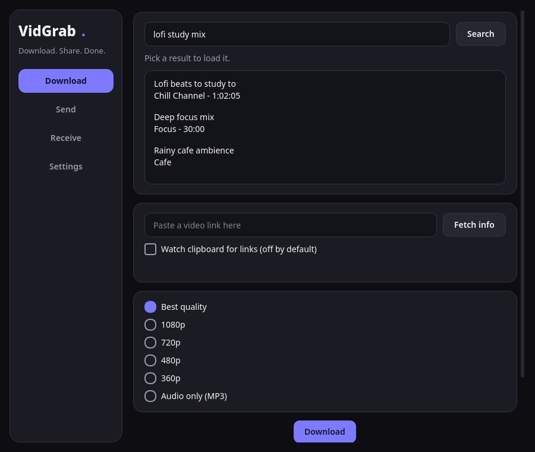
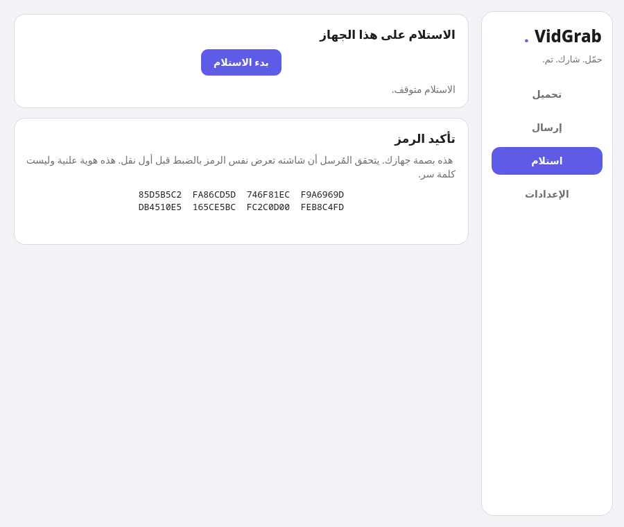
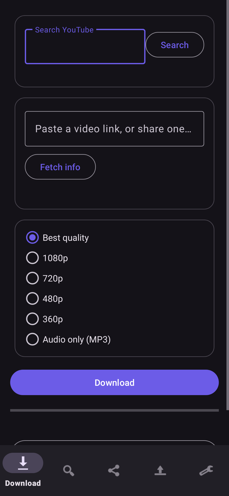
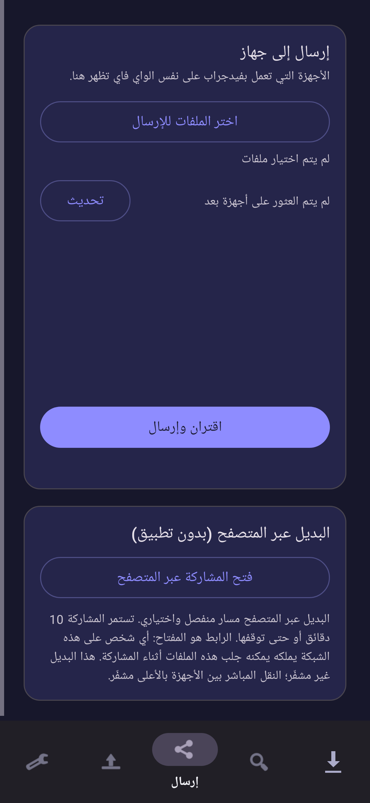

# VidGrab

Free, open-source, ad-free video downloader + local file sender, for **Android** and **Windows**.

- **Download videos:** share a video link to the app (or paste it), pick a quality (1080p / 720p / ... / MP3 audio), download with progress. Powered by [yt-dlp](https://github.com/yt-dlp/yt-dlp), which supports [hundreds of sites](https://github.com/yt-dlp/yt-dlp/blob/master/supportedsites.md).
- **Send files directly between devices:** on Android, two phones find each other over Bluetooth and move the file over Wi-Fi Direct (Google Nearby Connections) - no shared Wi-Fi needed - with the same 4-digit code shown on both screens to confirm the link. On the same Wi-Fi network (Android and Windows) devices find each other automatically and the file moves over an authenticated, encrypted (TLS) connection after a full-fingerprint comparison. No cables, no accounts, no cloud.
- **Browser fallback:** for devices without the app (iPhone, Mac, Linux, anything with a browser), an optional token-link + QR flow remains - explicitly started, clearly marked unencrypted.
- **Search and browse (v1.0.0):** YouTube search on Android and Windows. On Android, an in-app browser with a "Download this page" button, file downloads from web pages routed into the app, and a basic ad blocker (per-site shield, pop-up blocking). The ad-block list is derived from [EasyList](https://easylist.to) (see [docs/CREDITS.md](docs/CREDITS.md)).
- **Your look, your language:** Light, Dark and Glass themes, in English or Arabic (full RTL), on both apps.

## Screenshots

> These are **rendered previews**, not photos of a real device. The Windows images are drawn by the app's own UI code (the search results shown are sample data, and the fingerprint is a throwaway test identity). The Android images come from the project's UI render tests (Robolectric). Real screenshots will replace them.

| Windows: Download and search (Dark, English) | Windows: Receive (Light, Arabic) |
|---|---|
|  |  |

| Android: Download and search (Dark, English) | Android: Send (Glass, Arabic) |
|---|---|
|  |  |

## Honest scope (read this)

- Site coverage = yt-dlp's coverage. It is large and growing, but no downloader supports *every* video on *every* site. Some sites block downloads or change often; updating the engine (in-app button / `pip install -U yt-dlp`) fixes most breakage.
- **DRM-protected content (paid streaming services, encrypted video) is not supported and will not be added.**
- **Android-to-Android transfer works without a shared network** (Nearby Connections: Bluetooth to find the phone, Wi-Fi Direct for the bytes). It needs Google Play services on both phones, so phones without it (some Huawei) and iPhones are out. **Phone-to-Windows transfer still needs the same Wi-Fi network** (a phone hotspot works as a manual fallback). First trust between two devices is the full-fingerprint comparison on both screens - it is only as strong as actually comparing it. The protocol has not been independently audited; see [docs/PROTOCOL.md](docs/PROTOCOL.md).
- The optional **browser fallback is plain HTTP on the local network: it is not encrypted**. The link contains a random session token and sharing stops after 10 minutes or when you stop it, but treat the link like a key.
- The Android **ad blocker is basic**: it blocks known ad hosts and pop-ups opened without a tap. It will miss ads served from the same host as the content, and in-page or video ads. Some sites' downloads (blob: or script-made links) do not work in the in-app browser.
- You are responsible for having the right to download and keep the content you save. VidGrab does not check this for you.
- Download speed depends on the source site and your connection; no fixed speed is promised.

## Devices can't see each other?

Many routers block devices on the same Wi-Fi from talking to each other ("AP isolation" / "client isolation"). Fix it in the router admin page (usually `192.168.1.1`, credentials on the router sticker): wireless/WLAN settings → disable **AP/Client Isolation** → save. Don't use a Guest network - it always isolates. If you can't change the router, turn on the phone's hotspot, connect the other device to it, and transfer over that.

## Repository layout

```
vidgrab/
├── android/     Kotlin Android app (share target, downloader, native transfer)
├── windows/     Python desktop app (downloader + native transfer, PySide6/Qt UI)
├── docs/        Build, extend and protocol docs
└── LICENSE      GPL-3.0
```

## Android

Requirements: Android Studio (Hedgehog or newer), Android SDK 34, JDK 17. Device must run Android 10+ (API 29).

```bash
cd android
./gradlew assembleDebug      # APK at app/build/outputs/apk/debug/app-debug.apk
```

Or open `android/` in Android Studio and press Run. Install the APK on your phone, then share any video link from any app and choose **VidGrab**.

The download engine is the actively maintained [JunkFood02 fork of youtubedl-android](https://github.com/JunkFood02/youtubedl-android) `0.18.1` from Maven Central (the original's newer releases fail to build on JitPack). It bundles Python 3.12 and ffmpeg 7.1.1. Use the in-app **Update download engine** button to refresh yt-dlp itself to the latest version; to bump the engine base, edit `android/app/build.gradle.kts`.

## Windows

Requirements: Python 3.10+. **During installation, tick "Add python.exe to PATH"** (or install "Python 3.12" from the Microsoft Store).

Easiest: double-click **`run_windows.bat`** inside the `windows` folder. It installs the dependencies and starts the app.

Manual equivalent (in CMD inside `windows`):

```bash
py -m pip install -r requirements.txt
py vidgrab_app.py
```

If `py` is not found either, Python is not installed or not on PATH; reinstall it with the PATH box ticked.

Build a standalone `VidGrab.exe` (no Python needed afterwards):

```bash
cd windows
build_exe.bat        # -> dist/VidGrab.exe
```

## Tests

```bash
cd windows
python -m pytest test_core.py test_share.py        # unit + security tests
python -m pytest test_core.py --integration        # real network download test
```

## Publish to your own GitHub

```bash
cd vidgrab
git init
git add -A
git commit -m "VidGrab 0.1.0: video downloader + local file sender"
git branch -M main
git remote add origin https://github.com/YOUR-USERNAME/vidgrab.git
git push -u origin main
```

## Getting installable downloads (build in the cloud)

This repo includes a GitHub Actions workflow (`.github/workflows/build.yml`) that builds everything in the cloud - no local builds needed.

**Automatic: push a version tag.**

```bash
git tag v11
git push origin v11
```

The workflow builds the Android APKs and the Windows build, then creates a GitHub Release named after the tag with every file attached (`vidgrab-v11-arm64-v8a-debug.apk`, `vidgrab-v11-windows.zip`, the license notices and the ffmpeg source archives).

**Manual: run it yourself.**

1. On your repo page open the **Actions** tab → **Build binaries** → **Run workflow**.
2. When the run finishes, download its artifacts: **VidGrab.exe** (Windows, no Python needed), the **Android APKs**, `VidGrab-NOTICES.zip` (license notices), and the GPL ffmpeg source archives that belong with the binaries.
3. Attach them to a release yourself (**Releases** → **Draft a new release**) if you want public download links.

Notes:
- The APKs are **debug-signed pre-release builds**: fine for trying on your own devices (Android will ask to allow installing unknown apps), not signed with your own key yet. Proper release signing is on the roadmap.
- Phones: install the **arm64-v8a** APK (almost every modern phone). The universal APK works everywhere but is much larger.
- The Windows exe bundles the pinned GPL ffmpeg build (fetched and SHA-256 verified by `windows/vendor/fetch_ffmpeg.*`); the same build works locally with `build_exe.bat`.

## Roadmap (not built yet)

- Windows share-menu integration (MSIX packaging)
- QR-code camera scanning for first trust (today: compare the fingerprint text)
- Streaming sender (today the sending side buffers the file in memory)
- Download queue, pause/resume, per-site settings
- Signed release builds

## License

GPL-3.0, see [LICENSE](LICENSE). The Android app links against youtubedl-android (GPL-3.0), which requires the whole app to be GPL-compatible.

Credits and dependency licenses: [docs/CREDITS.md](docs/CREDITS.md). This tool is for content you have the right to download. Respect each site's terms and copyright law.

---

## تشغيل سريع (بالعربي)

**على ويندوز:**
1. ثبّت Python 3.10 أو أحدث من python.org، **ومهم: علّم على "Add python.exe to PATH" أثناء التثبيت** (أو ثبّت "Python 3.12" من متجر Microsoft).
2. دوس دبل-كليك على **`run_windows.bat`** جوه فولدر `windows`، وهو هيثبّت المطلوب ويفتح البرنامج.
3. لو ظهرلك 'pip is not recognized' أو 'py is not recognized': يبقى بايثون اتثبّت من غير PATH أو مش متثبّت أصلًا، أعد تثبيته وعلّم على خانة PATH، أو استخدم نسخة متجر Microsoft.
4. لو عايز ملف exe شغّال لوحده: شغّل `build_exe.bat` وهتلاقي `VidGrab.exe` في فولدر `dist`.

**على أندرويد:**
1. ثبّت Android Studio، افتح فولدر `android`، واستنى أول مزامنة.
2. وصّل موبايلك (Android 10 أو أحدث) وفعّل وضع المطوّر وUSB debugging، ودوس Run. أو نفّذ `./gradlew assembleDebug` وهتلاقي الـAPK في `app/build/outputs/apk/debug/`.
3. بعد التثبيت: دوس Share على أي فيديو في أي تطبيق واختار **VidGrab**، اختار الجودة، ونزّل.

**إرسال ملفات لأي جهاز:**
- من التطبيق (موبايل أو كمبيوتر): "Send files" ← اختار الملفات ← "Start sharing" ← هيطلعلك QR ولينك.
- على الجهاز التاني (نفس الواي فاي): افتح اللينك أو امسح الـQR في المتصفح العادي وحمّل. من غير أي برامج على الجهاز المستقبِل.
- اللينك شغال 10 دقايق بس أو لحد ما توقف المشاركة، وأي حد على نفس الشبكة معاه اللينك يقدر يحمّل الملفات دي وقتها، فاعتبر اللينك زي المفتاح.

**الأجهزة مش شايفة بعضها على الواي فاي؟**
- رواتر كتير بتعزل الأجهزة عن بعضها (خاصية AP/Client Isolation). من صفحة إعدادات الراوتر (غالباً `192.168.1.1` وبيانات الدخول على الاستيكر تحت الراوتر): إعدادات الواي فاي ← شيل تفعيل **AP/Client Isolation** ← احفظ. ومتستخدمش شبكة الضيوف (Guest) لأنها معزولة دايماً.
- لو مش قادر تغيّر إعدادات الراوتر: شغّل هوتسبوت الموبايل ووصّل الجهاز التاني عليه وانقل من خلاله.

**نسخ جاهزة للتحميل (بناء على جيت هاب):**
1. ارفع المشروع على جيت هاب زي قسم "Publish to your own GitHub" اللي فوق.
2. من صفحة المشروع افتح تبويب **Actions** ← **Build binaries** ← **Run workflow**.
3. لما البناء يخلص، حمّل الـartifacts: **VidGrab.exe** (شغّال من غير بايثون)، و**ملفات APK لأندرويد**، وملف `VidGrab-NOTICES.zip` (إشعارات التراخيص)، ومصدر ffmpeg المرافق للبرامج.
مفيش نشر تلقائي. لو عايز لينكات تحميل عامة، اعمل Release بنفسك (**Releases** ← **Draft a new release**) وارفع عليه الملفات دي بعد ما تتأكد منها.
- للموبايل نزّل ملف **arm64-v8a** (أغلب الموبايلات الحديثة). نسخة أندرويد دي نسخة تجريبية (debug) للتجربة الشخصية، وأندرويد هيسألك تسمح بالتثبيت من مصادر غير معروفة.

## New in v8
- Estimated size (approximate) next to each quality.
- Files tab: filter by Video / Audio / Images / Other, tap to open, long-press to delete.
- Android: in-app player, floating navigation bar.
- Auto-paste of a copied link when the app is focused (Settings switch on Android, "Watch clipboard" on Windows). Android reads the clipboard only while the app is in the foreground.

- v9: warm sand/taupe look (Dark/Light/Glass), My Files redesign with search and menu, quality rows, redesigned audio player.
- v11: nearby send between Android phones (Bluetooth + Wi-Fi Direct, no shared Wi-Fi), 4-digit code compared on both screens, same-Wi-Fi transfer kept as a fallback, and a tag-triggered GitHub Actions release.
